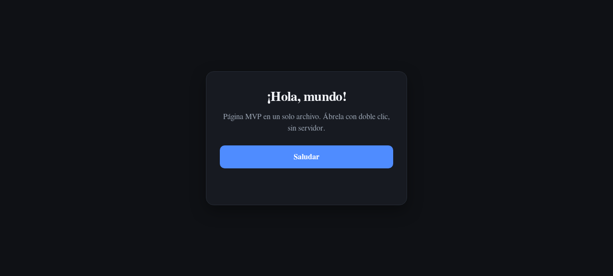
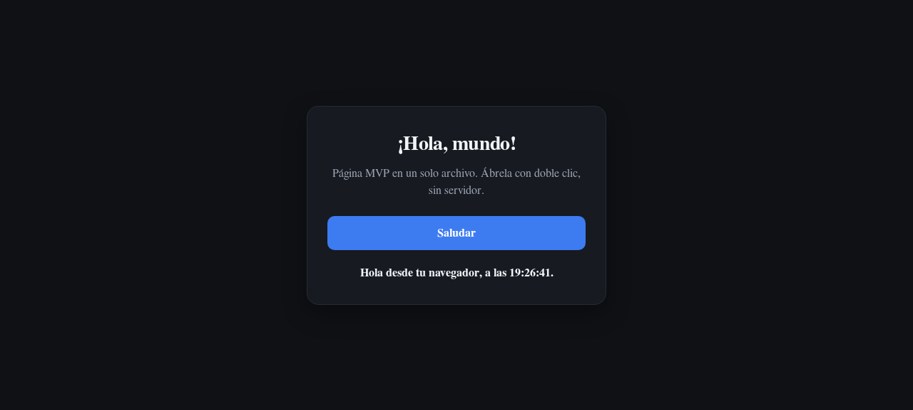

# Hola mundo, MVP

Página web mínima de hola mundo. Un solo archivo HTML, sin dependencias, sin
servidor y sin compilación.

## Cómo usarla

1. Descarga `index.html`.
2. Haz doble clic en él para abrirlo en tu navegador.
3. Pulsa "Saludar" y verás el saludo con la hora actual.

También funciona publicada en la web, por ejemplo con GitHub Pages.

## Capturas

Sin pulsar el botón:



Después de pulsar "Saludar":



## Archivos

```
index.html   la página completa (HTML, CSS y JavaScript en línea)
docs/        capturas de las dos pantallas
README.md    este archivo
```

## Una nota técnica

El JavaScript va en un script clásico en línea a propósito. Los módulos ES no se
cargan desde `file://`, así que un `<script type="module">` dejaría la página
sin funcionar al abrirla con doble clic.
